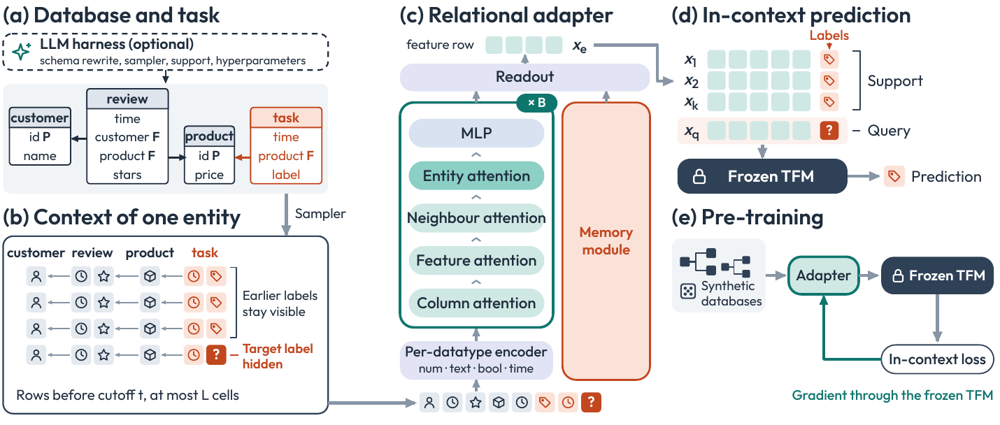

<div align="center">

# 🗄️ OpenRFM

**An open relational foundation model, pre-trained on synthetic databases alone.**

[](paper/openrfm.pdf)
[](https://arxiv.org/abs/2606.04320)
[](https://huggingface.co/zkchen/openrfm)
[](https://huggingface.co/datasets/zkchen/openrfm)
[](https://colab.research.google.com/github/Quant-Spirit/openrfm/blob/main/notebooks/openrfm_quickstart.ipynb)
[](https://www.python.org)
[](#-license)



</div>

## 📦 Installation

Requires Linux, Python 3.11 or 3.12, an NVIDIA GPU with a matching CUDA toolkit (`nvcc`), a C++20 compiler and a
[Rust toolchain](https://rustup.rs) 1.85 or later. Pre-training also needs `zstd` (to unpack the corpus).

```bash
pip install torch==2.9.1 --index-url https://download.pytorch.org/whl/cu128
pip install git+https://github.com/Quant-Spirit/openrfm
pip install "git+https://github.com/Quant-Spirit/openrfm#subdirectory=native/rustler"
```

From a checkout:

```bash
git clone https://github.com/Quant-Spirit/openrfm && cd openrfm
pip install . ./native/rustler          # use ".[train]" instead of "." for pre-training
```

> [!NOTE]
> The sampler kernels compile on first use (a few minutes) and are cached under `~/.cache/openrfm`.

## 🤗 Checkpoints

| File | Content |
|---|---|
| `openrfm_backbone.pt` | Relational adapter (backbone) |
| `openrfm_memory_v1.pt` | Memory module |

`openrfm predict` downloads both from [`zkchen/openrfm`](https://huggingface.co/zkchen/openrfm) and checks their sha256.
To keep them in a local folder:

```bash
hf download zkchen/openrfm openrfm_backbone.pt openrfm_memory_v1.pt manifest.sha256 --local-dir ckpt
openrfm predict --task rel-f1/driver-dnf --data DATA --checkpoints ckpt
```

## 🚀 Examples

**RelBench and 4DBInfer.** [`examples/relbench`](examples/relbench) predicts benchmark tasks with a released recipe.
Each database is downloaded into `DATA/` on first use (RelBench from its server, the four 4DBInfer databases from the
unchanged official archives in [`zkchen/openrfm-4dbinfer`](https://huggingface.co/datasets/zkchen/openrfm-4dbinfer)),
and the TEST metric is printed.

```bash
python examples/relbench/predict.py --data DATA                                   # the three rel-f1 tasks
python examples/relbench/predict.py --data DATA --recipe r1 --tasks rel-event/user-repeat rel-trial/study-outcome
python examples/relbench/predict.py --data DATA --tasks all                       # all 32 benchmark tasks
openrfm predict --task rel-f1/driver-dnf --recipe r2 --data DATA                  # one task from the CLI
```

**Your own database.** Read a SQL database, a Neo4j graph or data frames, define the task in SQL and predict:

```python
import openrfm
import pandas as pd

db = openrfm.Database.from_sql("postgresql://user@host/shop")      # keys from the schema's constraints
# db = openrfm.Database.from_sql("duckdb:///shop.duckdb")          # also sqlite:///..., mysql+pymysql://...
# db = openrfm.Database.from_neo4j("neo4j://host:7687", auth=("neo4j", "password"))
# db = openrfm.Database.from_frames({"orders": df, ...}, pkeys={...}, fkeys={...}, time={...})

task = openrfm.Task.from_sql(db, "customer-churn", entity="customers", target="churn", horizon="30D",
    timestamps=pd.date_range("2022-03-01", "2023-12-01", freq="MS"), val_start="2023-07-01", test_start="2023-10-01",
    label="""SELECT c.id, c.timestamp, COUNT(o.order_id) = 0 AS churn
             FROM cases c LEFT JOIN orders o
               ON o.customer_id = c.id AND o.order_time >= c.timestamp AND o.order_time < c."end"
             GROUP BY c.id, c.timestamp""")

pred = openrfm.predict(db, task)        # id, timestamp, prediction (and the label when known) per TEST row
```

| Source | How it is read |
|---|---|
| SQL database | `Database.from_sql(url)`: primary and foreign keys from the schema's constraints (`pip install "openrfm[sql]"` plus the database driver; DuckDB files need nothing more) |
| Neo4j | `Database.from_neo4j(uri)`: one table per node label, one per relationship type with `src` and `dst` keys; properties become columns (`pip install "openrfm[neo4j]"`) |
| Data frames | `Database.from_frames(tables, pkeys, fkeys, time)` |

A table's row time is its only datetime column, or the one `time={"table": "column"}` names (`None` for a static
table). `Task.from_sql` runs the label query in DuckDB over the table `cases(id, timestamp, "end")`, every entity at
every timestamp with `"end"` = timestamp + horizon, and splits the rows by time; `Task.from_frames` takes the three
splits directly.

[`examples/private`](examples/private) builds a simulated shop database and predicts its tasks this way, or from the
files on disk:

```bash
python examples/private/make_shop.py --out DATA
python examples/private/predict_sql.py --data DATA                                 # via a DuckDB file and SQL task
openrfm predict --spec examples/private/customer-churn.yaml --recipe r1 --data DATA  # via the files
```

**Colab.** [`notebooks/openrfm_quickstart.ipynb`](notebooks/openrfm_quickstart.ipynb) runs both examples.

## 🧰 CLI

### Inference

| Command | Description |
|---|---|
| `openrfm download --db DB --data DATA` | Download a benchmark database and its tasks |
| `openrfm predict --task TASK --recipe {r1,r2,r3} --data DATA` | Predict and score a benchmark task |
| `openrfm predict --spec TASK.yaml --recipe {r1,r2,r3} --data DATA` | Predict a task of your own database |
| `openrfm import --source URL --data DATA --name NAME` | Write a SQL database or a Neo4j graph into `DATA/NAME/` |
| `openrfm convert --db DB --data DATA --out ARCHIVES` | Convert a database into an archive |

`predict` also takes `--work DIR` (default `openrfm-work`) and `--checkpoints DIR`. It predicts every TEST row and writes
`WORK/<recipe>/<task>/{result.json,predictions.npz}`.

| Recipe | Setting |
|---|---|
| `r1` | Original schema, per-task context and support settings |
| `r2` | LLM-searched harness: the task's schema program in [`openrfm/configs/rewrite`](openrfm/configs/rewrite), its context and support settings and the record bank |
| `r3` | R2 plus a zero-initialised residual head on the frozen Kumo-Tabular prediction, trained per task on its support rows with checkpoint step selected on the temporal holdout |

Classification tasks are binary.

The 32 benchmark tasks (RelBench-V1, RelBench-V2, 4DBInfer) are listed in
[`openrfm/configs/infer/tasks.yaml`](openrfm/configs/infer/tasks.yaml).

### Pre-training

```bash
# backbone, on the released corpus
openrfm train backbone fetch  --config openrfm/configs/train/backbone.yaml --out CORPUS
openrfm train backbone train  --config openrfm/configs/train/backbone.yaml --corpus CORPUS --out RUN
openrfm train backbone export --checkpoint RUN/steps=40000.pt --out openrfm_backbone.pt

# backbone, on a newly generated corpus
cargo build --release --manifest-path native/worldgen/Cargo.toml
openrfm generate --config openrfm/configs/data/backbone_corpus.yaml --out GEN \
    --worldgen native/worldgen/target/release/worldgen \
    --worldgen-materialize native/worldgen/target/release/worldgen-materialize
openrfm train backbone corpus --config openrfm/configs/train/backbone.yaml --generated GEN --out CORPUS

# memory module, on the frozen backbone and the fetched corpus
cargo install --path native/rustler
openrfm train memory --config openrfm/configs/train/memory.yaml --corpus CORPUS --out RUN
```

| Command | Description |
|---|---|
| `train backbone fetch` | Download the [pre-training corpus](https://huggingface.co/datasets/zkchen/openrfm) (93 shards, ~77 GB) |
| `train backbone corpus` | Build a corpus from `openrfm generate` output |
| `train backbone train` | Pre-train the backbone (`--steps N`, `--resume CKPT`) |
| `train backbone export` | Write the released backbone file of a checkpoint |
| `train memory` | Train the memory module (`--steps N`, `--resume`) |
| `generate` | Generate synthetic worlds (`--families`, `--workers`) |

## 📁 Repository

| Path | Content |
|---|---|
| [`openrfm/synth`](openrfm/synth) | Synthetic world generators |
| [`openrfm/sampler`](openrfm/sampler) | Relational context sampler and its CPU/CUDA kernels |
| [`openrfm/models`](openrfm/models) | Backbone, memory module, Kumo-Tabular consumer, GPU kernels |
| [`openrfm/data`](openrfm/data) | `Database` and `Task`: SQL, Neo4j and data-frame sources |
| [`openrfm/rewrite`](openrfm/rewrite) | Executor of the schema programs |
| [`openrfm/infer`](openrfm/infer) | Inference pipeline |
| [`openrfm/train`](openrfm/train) | Pre-training of the backbone and the memory module |
| [`openrfm/configs`](openrfm/configs) | Data, rewrite, inference and training configurations |
| [`native`](native) | Rust world generator (`worldgen`) and archive converter (`rustler`) |

## 🗺️ Roadmap

- [ ] Open-source the LLM harness frontend and its evolutionary search loop
- [ ] Continual learning
- [ ] Reasoning-enhanced predictive model

## 📄 Citation

```bibtex
@article{chen2026openrfm,
  title   = {OpenRFM: Democratizing Frontier Predictive Intelligence on Relational Data},
  author  = {Chen, Zhikai and Yin, Junyu and Gu, Jialiang and Xiong, Siheng and Liu, Xiaoze and
             Zhang, Ruowang and Zhou, Keren and Guo, Kai},
  journal = {arXiv preprint arXiv:2606.04320},
  year    = {2026}
}
```

## ⚖️ License

OpenRFM is released under the [MIT License](LICENSE), except `native/rustler/` and `openrfm/models/backbone/`, which
are derived from [Relational Transformer](https://github.com/stanford-star/relational-transformer) and remain under
the Apache License 2.0 (see [NOTICE](NOTICE)). Inference uses the
[Kumo-Tabular](https://huggingface.co/nvidia/Kumo-Tabular) weights (OpenMDW-1.1) through `structured-data-models`
(Apache-2.0); backbone training uses [TabICL](https://github.com/soda-inria/tabicl) (BSD-3-Clause). The benchmark
databases keep the terms of their sources (RelBench, 4DBInfer and the datasets they are built from).
